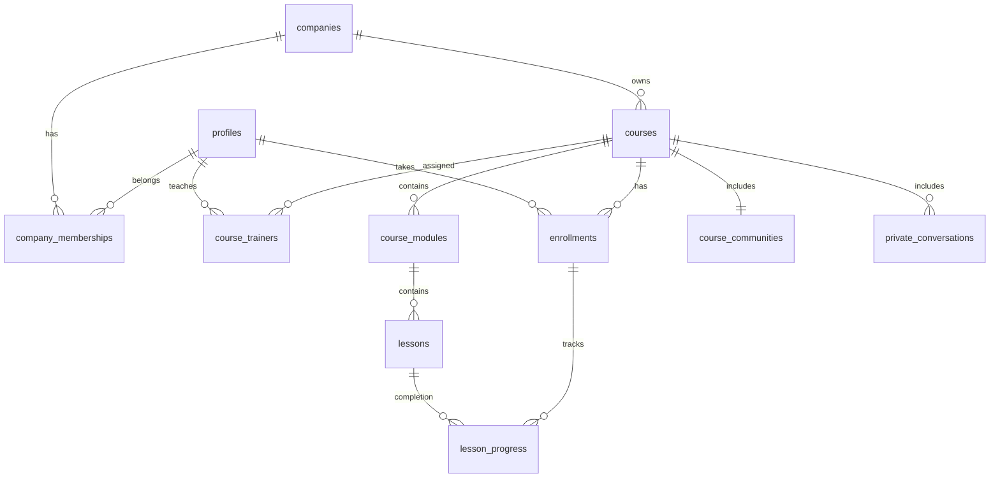

# Modelo de dominio

- **Estado:** propuesta para revisión funcional; no equivale a migraciones aplicadas.
- **Fecha:** 2026-11-22
- **Alcance:** plataforma de formación multiempresa (web y Android), marketplace de cursos, contenidos, seguimiento, comunidades y mensajería.
- **Documento relacionado:** `docs/decisions/ADR-001-kotlin-jdbc-identidad-rls.md`.

## 1. Decisiones funcionales confirmadas

1. Una instancia aloja múltiples empresas (**multi-tenant**); solo el **administrador global** crea empresas.
2. Una cuenta de usuario es global, compartida entre Android y web; puede relacionarse con varias empresas y tener roles distintos en ellas.
3. Cada empresa personaliza nombre, logotipo, colores y otros recursos visuales. No puede ejecutar HTML/JS arbitrario en clientes ajenos.
4. Cada curso pertenece a **una** empresa y puede tener **varios** formadores autorizados por esa empresa. Solo formadores autorizados publican y modifican cursos; la administración empresarial no obtiene por defecto capacidad editorial.
5. Usuarios externos pueden consultar un catálogo de cursos **públicos**. También existen cursos **privados**, accesibles mediante **código/enlace de invitación** válido, y se propone el estado opcional **no listado**. Ver una ficha o disponer de un enlace no equivale a poder consumir material protegido.
6. La plataforma permite **cursos públicos gratuitos** (inscripción directa por usuario autenticado) y cursos de pago con **compra simulada**, sin cobrar ni captar datos bancarios reales. Una operación confirmada concede una inscripción; un cliente no puede confirmar por sí mismo la compra.
7. Cada inscripción tiene su progreso individual. Un curso se organiza en módulos, lecciones, materiales, vídeos, ejercicios y evaluaciones configurables.
8. Cada curso tiene comunidad restringida a inscritos y formadores autorizados. El alumno puede conversar privadamente con formadores; por curso, la empresa podrá configurar **elección del formador** o **asignación** (o ambos si así se configura).
9. Una invitación válida a curso privado puede ser **gratuita** (regalo/promoción, matriculación sin pago) o **condicionada a compra simulada**, según la modalidad configurada al emitirla. El enlace/código por sí solo nunca da acceso al contenido.
10. Los administradores de cada empresa pueden consultar **estadísticas generales y progreso/calificaciones individuales** de las inscripciones en cursos de su empresa, con acceso de solo lectura y sin acceso a mensajes privados ni a otras empresas.
11. Los datos entre empresas y entre cursos están aislados salvo excepciones explícitas como el catálogo público.
12. El backend se reconstruirá con Kotlin y PostgreSQL, y los clientes web/Android usarán la misma API. La identidad la gestiona Supabase Auth.

## 2. Vocabulario e identidades

### Alta de empresa y continuidad de administración (decisión aceptada)

Solo el administrador global verificado puede solicitar un alta. Designa a una persona ya existente, confirmada, activa y permanente en el mismo proyecto de Auth. El servidor resuelve su identidad canónica por UUID desde una fuente autorizada. Una dirección de correo o un identificador entregado por el solicitante solo sirve para buscar un candidato. Volver a comprobar la elegibilidad al conceder la membresía. El designado puede ser distinto del actor global y recibe exclusivamente el rol empresarial de esa compañía.

La futura capacidad SQL limitada ejecutará una única transacción que comprueba el perfil vinculado a Auth (o lo aprovisiona idempotentemente según la política elegida), crea la empresa, inserta la membresía activa de su primer `company_admin` y registra el evento durable de éxito. La empresa solo resulta visible como activa tras el commit. La clave de idempotencia se vincula a actor, operación y solicitud canónica. Una repetición idéntica recupera el resultado. Un cambio de destinatario o datos con la misma clave produce conflicto. Ante fallo de asignación, auditoría o validación se revierte todo. Tras perder la respuesta se consulta el resultado antes de reintentar. Los intentos fallidos se registran fuera de la transacción revertida, sin exponer datos innecesarios.

Cada empresa activa debe conservar al menos un administrador activo. Para degradar, suspender, trasladar o eliminar una membresía administrativa, bloquear primero la fila de empresa, comprobar el estado resultante bajo el bloqueo y aplicar el cambio en esa transacción. Todos los caminos de escritura deben respetar la misma serialización, incluidas bajas de perfil, tareas administrativas y reactivaciones. Prohibir DML directo que eluda la operación y evitar borrados en cascada de la identidad que dejen una empresa huérfana. Para sustituir al último administrador, verificar y activar al sucesor antes de retirar al anterior en la misma transacción. Registrar actor, empresa, transición y correlación. Un administrador empresarial jamás puede modificar el UUID global ni ejecutar la capacidad de plataforma.

Una baja inesperada en Auth puede dejar al único administrador sin posibilidad de iniciar sesión aun con una membresía activa. Coordinar las bajas planificadas con sustitución previa, detectar divergencias de Auth, restringir operaciones administrativas y abrir recuperación operativa auditada con verificación del nuevo titular. La recuperación no habilita un segundo administrador global ni concede acceso a chats. La integración con el ciclo de vida de Auth y la elección del soporte duradero de auditoría siguen pendientes de prueba. [Procedimiento de plataforma](security-model.md#administración-de-plataforma)

- **Identidad**: usuario autenticado por Supabase Auth (`auth.users.id`, UUID), común a todos los dispositivos.
- **Perfil**: información no sensible de la cuenta global; no almacena contraseñas.
- **Empresa / tenant**: entidad propietaria de cursos, identidad visual y miembros.
- **Membresía empresarial**: vínculo entre usuario y empresa; contiene rol y estado. Estar matriculado en un curso **no implica** ser miembro interno de la empresa que lo ofrece.
- **Formador asignado**: usuario expresamente autorizado a impartir/editar un curso; la pertenencia a un rol empresarial de formador no basta para editar cualquier curso.
- **Inscripción**: derecho de acceso de un alumno a un curso, independientemente de cómo se obtuvo (compra simulada, invitación, concesión administrativa futura).
- **Administración global**: privilegio de plataforma, **distinto** de un rol de empresa; se autoriza desde el backend mediante identidad verificada y mecanismo privilegiado separado.

## 3. Entidades y relaciones objetivo (no todas son de la primera migración)

| Entidad | Propiedad / cardinalidad | Reglas principales |
|---|---|---|
| `profiles` | 1:1 con `auth.users` | `id` = UUID de Auth, sin contraseña; datos de perfil editables por propietario dentro de límites. |
| `companies` | tenant raíz | `id` UUID; `slug` único, `status` activo/suspendido; solo administración global la crea. |
| `company_memberships` | N:M `profiles` ↔ `companies` | clave única `(company_id,user_id)`; rol `company_admin`, `trainer` o `member`; estado `invited`,`active`,`suspended`; recomendación: no duplicar filas al cambiar rol. |
| `company_branding` | 1:1 empresa (fase posterior) | colores, logotipo, portada y activos seguros; evitar CSS/JS libre. |
| `courses` | N:1 empresa | `visibility` `public`,`unlisted`,`private`; `status` `draft`,`published`,`archived`; propietario nunca cambia implícitamente. |
| `course_trainers` | N:M cursos ↔ usuarios | formador asignado, indicador opcional de responsable; la asignación se valida contra membresía autorizada de empresa. |
| `course_invitations` | N:1 curso | código/enlace aleatorio e impredecible, almacenado como hash; `redemption_mode` = `complimentary` o `simulated_purchase`; expiración, revocación, cupos y asociación opcional a destinatario; no es sesión ni compra. |
| `enrollments` | N:M usuarios ↔ cursos | unicidad de inscripción activa por `(course_id,user_id)` (el modelo de historial/reinscripción se concretará); origen y estado de acceso. |
| `simulated_orders`, `simulated_order_items` | N:1 comprador / curso | dinero en enteros de unidad mínima, moneda ISO, precio histórico y posible descuento; `pending`,`completed`,`failed`,`cancelled`; transiciones idempotentes. No se crean para inscripciones gratuitas. |
| `course_modules` | N:1 curso | orden explícito, título y estado publicado. |
| `lessons` | N:1 módulo | orden explícito, tipo y contenido; contenido protegido por inscripción. |
| `lesson_materials` | N:1 lección | texto, recurso documental o referencia externa. |
| `videos` | N:1 lección | proveedor y `storage_key`/URL; nunca guardar bytes grandes en PostgreSQL; medios privados requieren autorización para obtener enlace temporal. |
| `exercises`, `questions`, `submissions` | ejercicios por lección; entregas por inscripción | límites de intentos, calificación y corrección automática/manual. |
| `lesson_progress` | N:1 inscripción y lección | único `(enrollment_id,lesson_id)`; estados y tiempo de finalización; no confiar en porcentajes enviados por clientes. |
| `course_communities` | 1:1 curso (decisión propuesta) | solo actores autorizados al curso; no confundir con comunidades empresariales generales. |
| `community_posts`, `post_comments`, `reactions` | N:1 comunidad/publicación | autor, moderación, ediciones y borrado lógico cuando aplique. |
| `course_chat_settings` | 1:1 curso | modo `student_selects`, `assigned`, `both`; reglas de asignación de tutor. |
| `private_conversations`, `conversation_participants`, `messages` | conversaciones asociadas a curso | participantes explícitos; únicamente alumno de ese curso y formador/es autorizados; acceso independiente de comunidad. |
| `notifications`, `audit_events` | por usuario/actor | notificaciones y trazabilidad para accesos administrativos, cambios de rol, invitaciones y compras simuladas. |

### Relaciones esenciales

## 4. Invariantes de negocio y seguridad

- Cada registro tenant-scoped lleva `company_id` explícito o tiene una relación **inequívoca** con un padre tenant-scoped. El backend no acepta `company_id` arbitrario para elevar permisos.
- Los identificadores se comprueban junto a su empresa/curso; usar UUID aleatorios no sustituye autorización.
- Un curso privado nunca aparece en búsqueda pública. Su ficha de invitación puede mostrar solo metadatos mínimos si el token es válido; el contenido requiere inscripción activa.
- Un curso público permite leer **metadatos de catálogo publicados**, incluido precio (puede ser cero), no el material, los alumnos inscritos, la comunidad ni los mensajes. Un curso gratuito público permite inscripción directa de usuarios autenticados sin crear compra simulada.
- Cambiar curso de público a privado elimina su descubribilidad, **sin revocar automáticamente** inscripciones existentes; esta regla puede revisarse antes de implementarla.
- Solo una persona con asignación vigente como formador de ese curso puede editarlo/publicarlo. Los administradores empresariales gestionan membresías y asignaciones según política, sin acceso automático a chats privados.
- La inscripción se crea solo mediante un flujo autorizado (curso público gratuito, compra simulada completada o invitación `complimentary` canjeada); un cliente no puede declararse inscrito ni marcar su propia compra como completada. Una invitación `simulated_purchase` requiere la compra simulada completada antes de otorgar acceso. Todas las rutas son idempotentes y no duplican la inscripción activa.
- Cada invitación está ligada a un curso concreto, tiene una modalidad de canje inmutable una vez emitida, y puede aplicar una promoción de regalo (100 % de acceso) o exigir un importe simulado. La validez del código se comprueba al canjear y, para invitaciones de pago, al confirmar la operación; revocación/caducidad no retiran automáticamente accesos ya concedidos.
- Los administradores de empresa consultan estadísticas agregadas y progresos/calificaciones individuales **solo de inscripciones correspondientes a cursos de su empresa**; acceso de solo lectura con registros de auditoría para consultas sensibles. No se extiende a chats privados, empresas ajenas ni a edición de notas.
- Una compra simulada confirma en una transacción de servidor con idempotencia, nunca mediante un `UPDATE` ejecutado por el cliente.
- Cada avance se valida respecto a una inscripción activa y a una lección que pertenece al mismo curso; el porcentaje agregado se **calcula**, no se acepta del frontend como fuente de verdad.
- El alumno solo ve mensajes privados de conversaciones donde participa; el administrador empresarial y el administrador global **no** tienen permiso ordinario de lectura del contenido de chats privados.
- Los cursos publicados y su progreso histórico se archivan de forma conservadora; no se eliminan en cascada por una acción accidental de UI.
- Todos los archivos privados (vídeos, entregas, adjuntos) siguen controles equivalentes a los registros de la BD; las URLs firmadas expiran.
- Ningún cliente web/Android conoce la contraseña JDBC, `service_role` ni secretos del backend.

## 5. Matriz de permisos propuesta

Leyenda: **S** sí; **P** con condición (curso asignado, compra/inscripción válida o propiedad); **N** no. `Visitante` = sin sesión; `Usuario` = autenticado sin rol empresarial; `Admin. empresa` = administrador **de esa** empresa; `Formador` = asignado al curso, salvo cuando se indique; `Alumno` = inscrito en curso. Los roles se evalúan por recurso, no son privilegios globales.

| Operación | Visitante | Usuario | Admin. empresa | Formador asignado | Alumno inscrito | Admin. global |
|---|:---:|:---:|:---:|:---:|:---:|:---:|
| Ver catálogo de cursos publicados públicos | S | S | S | S | S | S |
| Ver un curso privado sin invitación válida | N | N | N* | N* | P | N* |
| Crear empresa | N | N | N | N | N | S |
| Gestionar imagen/marca de la propia empresa | N | N | S | N | N | P |
| Gestionar miembros y autorizar formadores | N | N | S | N | N | P |
| Crear curso de la propia empresa | N | N | N | P** | N | N |
| Editar o publicar curso | N | N | N | P | N | N |
| Asignar formadores a cursos | N | N | S | N | N | P |
| Inscribirse directamente en curso público gratuito | N | P | P | P | P | P |
| Comprar de manera simulada curso público de pago | N | P | P | P | P | P |
| Canjear invitación privada gratuita | N | P | P | P | P | P |
| Canjear invitación privada con compra simulada | N | P | P | P | P | P |
| Ver contenido protegido de curso | N | N | N* | P | S | N* |
| Registrar progreso propio | N | N | N | P*** | S | N |
| Consultar estadísticas, progreso y notas de cursos de la empresa (solo lectura) | N | N | S | P | N | N* |
| Leer/publicar en comunidad de curso | N | N | N* | P | S | N* |
| Moderar comunidad de curso | N | N | P | P | N | N* |
| Chat privado alumno-formador | N | N | N | P | P | N |
| Consultar datos privados de otra empresa | N | N | N | N | N | N |

`*` No se concede acceso implícito: puede obtenerse mediante una inscripción/asignación explícita o una herramienta administrativa extraordinaria auditada, todavía no diseñada. `**` Propuesta: formadores activos de la empresa pueden crear borradores de cursos; el creador queda asignado automáticamente como formador del curso en la misma transacción. `***` Solo si el formador también posee inscripción como alumno; el rol de formador no autoriza suplantar el progreso de otros. Los permisos de estadísticas, progreso y calificaciones para administradores **están confirmados**, limitados a los cursos de su empresa y solo lectura. La matriz sigue siendo propuesta técnica a verificar con pruebas; el modelo de moderación aún está por precisar.

## 6. Primer incremento: migración de tres tablas (propuesta, aún no ejecutada)

Se propone la secuencia:

1. `profiles (id UUID PRIMARY KEY REFERENCES auth.users(id), display_name, avatar_path, created_at, updated_at)`.
2. `companies (id UUID PRIMARY KEY, slug UNIQUE, name, status, created_at, updated_at)`.
3. `company_memberships (company_id FK, user_id FK, role, status, created_at, updated_at, PRIMARY KEY(company_id,user_id))`.

**Condiciones de implementación:**

- Primero inspeccionar las tablas y migraciones existentes, especialmente `Community`, y las dependencias Android. Nunca sobrescribir ni eliminar tablas sin análisis y plan de compatibilidad.
- Confirmar que el entorno local de pruebas tiene el esquema/usuarios de Auth necesario o una representación de prueba claramente separada; no asumir que un contenedor PostgreSQL vacío incluye `auth.users`.
- Migraciones versionadas con Flyway, con constraints, índices, `NOT NULL`, RLS habilitado, grants mínimos y políticas.
- Roles `company_admin`, `trainer`, `member` y estados no son permisos mágicos: toda operación se comprueba en backend y en políticas de filas.
- Bootstrap aceptado: UUID único de Auth en configuración protegida, MFA reciente y revocación operativa. El alta de empresa y su primera membresía administrativa se confirman atómicamente. Implementación y pruebas pendientes.
- Si todas las lecturas de `companies` bajo rol runtime están sujetas a RLS, un administrador global debe utilizar un flujo **separado y auditado** de administración de plataforma para crear/listar empresas; no ampliar la política de tenants a todos los usuarios autenticados.
- No introducir cursos ni pagos en esta primera migración; sí fijar el contrato para fases siguientes.

## 7. Pruebas de aceptación del incremento 1

Las pruebas se ejecutan con **el mismo rol JDBC runtime**, grants, RLS y configuración de contexto que usará Ktor; no como `postgres` ni como propietario/bypassrls.

1. Sin identidad: leer o modificar empresas/membresías privadas falla o devuelve cero filas, según operación.
2. Miembro activo de empresa A ve su empresa y su membresía; no ve miembros privados de B.
3. Miembro de A no puede insertar, modificar ni eliminar filas en B, ni cambiar su propio rol a `company_admin`.
4. Usuario en A y B ve ambos ámbitos únicamente cuando el backend autoriza su selección; no gana privilegios entre empresas.
5. Usuario suspendido o sin membresía no obtiene acceso interno.
6. Dos solicitudes sucesivas reutilizando conexión del pool, primero como usuario A y luego B, no intercambian visibilidad ni arrastran identidad.
7. Ausencia de contexto de identidad, fallo o rollback de transacción deja la conexión sin identidad persistente.
8. Registrar evidencia automatizada de la identidad SQL (`current_user`), `rolbypassrls=false`, propietario de tablas distinto del rol runtime, políticas activas y grants mínimos.
9. Crear empresas requiere el flujo privilegiado global y deja evento de auditoría cuando se implemente; el rol de usuarios normales no puede crear empresas aunque manipule JSON/IDs.
10. Al agregar cursos, repetir pruebas para aislamiento **por curso**: no inscritos no leen comunidad/lecciones/chat, y un inscrito en Curso 1 no ve conversaciones del Curso 2.
11. Al agregar inscripción/marketplace: curso público gratuito permite matrícula sin orden; invitación `complimentary` válida concede matrícula sin orden; invitación `simulated_purchase` exige orden completada; código inválido/revocado/caducado no concede matrícula; repetición no duplica acceso.
12. Al agregar informes: admin de empresa A ve estadísticas y calificaciones de alumnos de cursos A sin poder modificarlas, pero no ve cursos de empresa B ni chats privados; alumno ajeno no ve calificaciones de terceros.

## 8. Decisiones funcionales pendientes (no bloquear incremento 1)

- Confirmar si el modo `unlisted` se incorpora desde la primera versión.
- Determinar quién puede configurar la política del chat y cómo se asigna el tutor por defecto.
- Definir rol de formador responsable, permisos de colaboradores y sustitución de formadores.
- Precisar quién emite invitaciones privadas, duración/cupo por defecto, destinatario, promoción parcial frente a regalo completo y comportamiento de reintentos, manteniendo las dos modalidades confirmadas (gratis y compra simulada).
- Definir moneda predeterminada, descuentos parciales, reembolsos simulados y continuidad de las matrículas.
- Precisar informes de administración (métricas y columnas visibles, exportación, auditoría y minimización de datos) sin permitir acceso a mensajes privados.
- Decidir políticas de versiones de cursos y cambios en su contenido durante una matrícula.
- RGPD: edades admitidas, retención, exportación y eliminación de datos, reportes/denuncias y plazos de eliminación.
- Definir moderación de archivos, restricciones de subida y proveedor de vídeo; no insertar URLs públicas de materiales confidenciales.

## 9. Fuera del alcance inmediato

Pasarela de pagos real, certificados verificables, recomendaciones algorítmicas, video-transcodificación propia, chat grupal entre empresas, facturación y herramientas de superadministración completas. Deben poder añadirse sin vulnerar las invariantes anteriores.
