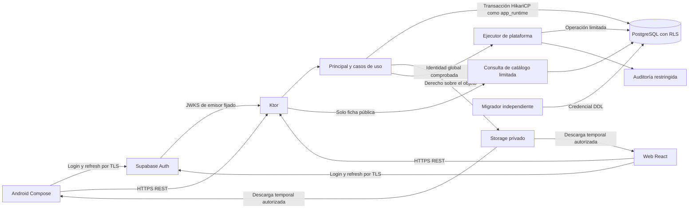

# Modelo de seguridad de Nexora

**Diseño de Fase 0, 22 de noviembre de 2026.** La API observada es local y anónima. Los permisos siguientes describen el objetivo de la plataforma. La evidencia requerida para aceptarlos está en la [matriz de pruebas](test-strategy.md). Las decisiones funcionales de referencia proceden del [dominio](domain-model.md) y el diseño inicial del [ADR](decisions/ADR-001-kotlin-jdbc-identidad-rls.md).

## Arquitectura y fronteras propuestas

Clientes y recursos externos son fronteras de confianza. Solo el backend interpreta el token de usuario para solicitudes de negocio. Supabase Auth gestiona credenciales y sesiones. PostgreSQL conserva relaciones vigentes. El catálogo y el ejecutor de plataforma tienen superficies SQL limitadas. El migrador funciona fuera del proceso que atiende clientes. El almacenamiento necesita controles propios sobre los bytes. El proyecto real, sus grants y su configuración de claves y buckets no se inspeccionaron.

## Identidad, sesión y autorización

1. Android y web inician sesión, recuperan cuenta y renuevan tokens a través de Auth. Fijar proyecto, callbacks admitidos y flujo PKCE en los clientes que redirigen. Enviar exclusivamente access token de usuario a rutas privadas mediante Bearer sobre HTTPS. Identidad canónica: UUID de sub dentro del emisor configurado. Nunca vincular cuentas a partir del texto de un email local.
2. Ktor autentica antes de adquirir conexión. Biblioteca JOSE mantenida, algoritmos asimétricos permitidos por configuración, correspondencia de tipo/uso de clave y algoritmo, firma, issuer exacto, audiencia esperada del cliente autenticado, exp obligatoria y nbf cuando exista, con reloj UTC y tolerancia acotada. Validar sub como UUID y clase de token de sesión del proyecto. Rechazar tokens de otro proyecto, tokens de servicio, claves públicas de API, refresh tokens y formatos inesperados. Decidir explícitamente si se admiten sesiones anónimas de Auth para operaciones que exigen cuenta registrada.
3. Resolver kid exclusivamente contra JWKS HTTPS configurado para ese emisor. Caché acotada, una renovación agrupada y limitada ante clave desconocida, rotación con solapamiento y retirada según política. Error de red sin clave válida impide la operación. Distinguir indisponibilidad de credenciales inválidas en telemetría sin revelar el token. Acordar purga de caché en retirada urgente y probarla. Si el proyecto usa secreto simétrico heredado, preferir migración a firma asimétrica o acordar verificación soportada por Auth. No habilitar dos mecanismos por conveniencia. [Supabase JWT](https://supabase.com/docs/guides/auth/jwts) · [Rotación de claves](https://supabase.com/docs/guides/auth/signing-keys) · [Ktor JWT](https://ktor.io/docs/server-jwt.html)
4. El principal inmutable aporta usuario y, donde proceda, identificador verificado de sesión. El servidor resuelve empresa, membresía, estado, asignación, inscripción y participantes para cada operación sobre el recurso real. IDs de la URL seleccionan un recurso candidato. Descartar roles, autor, precio, pertenencia y estado privilegiado enviados por el cliente. Cargar relaciones dentro de la misma transacción que la mutación y serializar con revocaciones cuando afecten al derecho concedido.
5. Cierre de sesión: especificar dispositivo actual o todas las sesiones, invalidar refresh mediante Auth, limpiar cachés por usuario, tokens, medios privados y tareas pendientes. Coordinar renovaciones concurrentes y gestionar fallo de red al cerrar sesión. La verificación de firma por sí sola permite usar un access token ya emitido hasta exp. Definir TTL y ventana admisible. Para administración sensible se propone verificar además la vigencia de la sesión mediante un mecanismo limitado por session_id, con fallo cerrado y sin grants amplios sobre auth. Retirar membresía/asignación se verifica en la BD aunque el token siga vigente. [Sesiones de Supabase](https://supabase.com/docs/guides/auth/sessions)
6. Solo el UUID de plataforma configurado en el backend puede solicitar la creación de empresas. El procedimiento siguiente regula alta, autenticación reforzada, revocación y recuperación.

## Administración de plataforma

**Decisión aceptada, implementación pendiente.** Existe como máximo un administrador global habilitado por entorno. La autoridad de despliegue custodia en configuración protegida `NEXORA_GLOBAL_ADMIN_SUB` y el emisor exacto de Auth. Configuración ausente, inválida, ambigua o en rotación cierra la operación de plataforma. Solo personal de operación autorizado puede cambiar esa configuración con revisión y trazabilidad. No existe un alta de administrador global en la API.

1. **Aprovisionar.** Un operador verifica a la persona por el procedimiento organizativo, comprueba su cuenta confirmada, activa y permanente en el proyecto correcto, y obtiene el UUID de una fuente administrativa de Auth de confianza. Verifica inscripción de MFA y custodia de un segundo factor de recuperación antes de habilitar el único UUID. Registrar responsable, entorno, cambio y fecha en un registro de operación restringido. Los emails, campos del cliente y metadatos editables carecen de autoridad para este proceso.
2. **Autorizar cada operación sensible.** Verificar JWT, emisor, audiencia, tiempos y sub como en la sección de identidad. Exigir igualdad exacta del UUID, sesión vigente de esa cuenta, nivel MFA `aal2` verificado y evidencia fiable de desafío reciente ligada a esa sesión. La fecha de emisión de un token renovado no demuestra que se haya repetido MFA. Si faltan evidencia reciente, ventana configurada, cuenta habilitada o disponibilidad del verificador, pedir nuevo desafío o denegar antes de adquirir la conexión privilegiada. La duración de la ventana y el modo de consultar la vigencia necesitan ensayo con Auth. [MFA de Supabase](https://supabase.com/docs/guides/auth/auth-mfa) · [Sesiones de Supabase](https://supabase.com/docs/guides/auth/sessions)
3. **Limitar la capacidad SQL.** Diseñar un ejecutor de plataforma separado, con credencial exclusiva y acceso solo al caso de alta. En F2, concederle USAGE sobre un esquema privado y EXECUTE únicamente sobre la firma exacta de la operación de alta. Sin acceso directo de escritura a las tablas. Retirar EXECUTE de PUBLIC y de los roles ordinarios en la misma migración. Una función SECURITY DEFINER de SQL fijo tendrá propietario dedicado NOLOGIN, sin propiedad de tablas ni BYPASSRLS, grants de columna y políticas explícitas solo para sus lecturas/escrituras imprescindibles. Fijar search_path con esquemas confiables y pg_temp al final, calificar objetos y prohibir SQL dinámico. El migrador crea los objetos. app_runtime no puede invocar ni asumir el ejecutor o su propietario. El ejecutor confía en la identidad autenticada por el componente privilegiado. Un UUID entregado como argumento SQL por sí solo jamás prueba el privilegio. El entorno local inicial aún no instala esta capacidad.
4. **Auditar y revocar.** Registrar intentos, denegaciones y resultados con actor, ámbito, correlación, hora y resultado, sin tokens ni factores. Registrar el éxito de un alta en la misma transacción que sus efectos. Para revocar, bloquear la ruta en todas las réplicas, detener o drenar operaciones privilegiadas en curso, retirar el UUID, invalidar las sesiones en Auth y verificar denegación con el token anterior todavía no caducado. Si hubo compromiso, rotar también las credenciales afectadas y revisar la auditoría. Un cambio de configuración parcial mantiene la ruta cerrada.
5. **Recuperar.** Emplear factor alternativo previamente inscrito con nueva verificación de identidad. Si la cuenta o todos sus factores están comprometidos, mantener deshabilitada la capacidad, verificar al custodio por un canal independiente y obtener aprobación operativa de una segunda persona. Recuperar en Auth o aprovisionar una nueva identidad con MFA. Revocar las sesiones antiguas, sustituir el único UUID desde el despliegue y verificar acceso reforzado de la cuenta recuperada y rechazo de la anterior antes de reabrir. Auditar motivo y resultado. La segunda persona revisa el cambio de configuración y no adquiere privilegios de aplicación.

## Matriz de permisos por recurso

Una celda de «actores autorizados» enumera todas las relaciones que habilitan esa operación. Quien no reúne una relación admitida queda denegado. Los permisos pueden acumularse para la misma persona según sus relaciones reales. La columna de estado distingue requisitos de reglas que aún requieren acuerdo.

| Acción | Actores autorizados y condición | Límite | Estado |
|---|---|---|---|
| Catálogo | Cualquiera, incluso visitante | Solo ficha allowlist de curso público publicado. | Requisito |
| Ficha privada / no listada | Destinatario con invitación válida para la ficha privada mínima. Resolver audiencia de enlace no listado. | Ni URL ni ficha conceden medios, matrícula o chat. | Parcialmente pendiente |
| Crear empresa | Admin global verificado, por operación de plataforma | Auditar actor, empresa y resultado. Rol ordinario sin INSERT. | Requisito con mecanismo propuesto |
| Perfil | Propietario de la cuenta | Editar campos públicos permitidos. UUID inmutable. Otros actores solo obtienen la proyección necesaria aprobada. | Propuesta |
| Marca y miembros | Admin activo de esa empresa | Restringir a campos y transiciones aprobados. Impedir autoelevación y traslado de membresía. | Protección del último admin aceptada. Otras delegaciones pendientes |
| Crear, editar y publicar curso | Alta por formador activo autorizado por empresa. Edición por asignado vigente de ese curso | Alta + asignación atómicas propuestas. Competencias de principal y colaboradores pendientes. | Requisito y propuesta |
| Asignar formadores | Admin de esa empresa conforme a la política | El asignado debe estar autorizado en la misma empresa. | Modelo inicial |
| Obtener inscripción | Usuario autenticado por vía gratuita, regalo o confirmación simulada válida | Exclusivamente para el comprador/destinatario determinado en servidor. | Requisito |
| Material privado y progreso | Inscrito activo del curso para contenido y progreso propio. Formador asignado para trabajar en el contenido | El formador necesita matrícula para registrar progreso personal. | Requisito |
| Informes | Admin de la empresa de los cursos y formador de sus cursos asignados según permiso | Solo lectura, detalle académico mínimo, sin chats ni cambio de nota por cargo. Alumno consulta su propio resultado. | Requisito con columnas pendientes |
| Comunidad | Alumno activo o formador vigente del curso. Moderador habilitado en el alcance acordado | Autorización por curso también en adjuntos, reportes y eventos. | Requisito con delegación pendiente |
| Chat | Participante explícito con relación vigente alumno/formador en ese curso | Ni admin empresarial ni global adquieren lectura por su cargo. Cambio de tutor/historial por decidir. | Requisito |
| Emitir o revocar invitación y calificar entregas | Requieren capacidad explícita por curso | No habilitar emisión, moderación ni corrección manual hasta definir quién, cuándo y qué puede ver. | Pendiente |

## PostgreSQL, JDBC y RLS

**Roles y superficie SQL.** Proponer esquema de negocio privado no expuesto por Data API, rol de propiedad sin login y credencial separada para migraciones. app_runtime con LOGIN, sin propiedad, superusuario, BYPASSRLS, CREATEROLE, CREATEDB, replicación ni vía de herencia o SET ROLE a roles privilegiados. Conceder CONNECT y USAGE solo donde proceda, privilegios de tabla/columna y EXECUTE por operación. Revisar privilegios efectivos de PUBLIC y predeterminados del creador, CREATE en esquemas, secuencias, funciones, vistas, particiones y grants a anon/authenticated. Evitar TRUNCATE, DDL y acceso general a auth.users/sessions. Desactivar la exposición innecesaria por REST/GraphQL, RPC, Realtime y Storage o restringir los esquemas y verificar los grants. El catálogo debe funcionar aun sin identidad y solamente mediante su proyección. [Protección de la Data API](https://supabase.com/docs/guides/api/securing-your-api)

**Unidad de trabajo.** Tras validar el principal, adquirir una conexión y abrir transacción explícita con autocommit desactivado. Establecer `set_config('app.user_id', ?, true)` con el UUID verificado mediante parámetro. Las operaciones de empresa seleccionada resuelven primero la pertenencia activa del principal. Para un actor que pertenece a A y B, proponer ámbito empresarial local validado además del usuario en las consultas de administración. El descubrimiento de sus propias membresías y la matrícula externa necesitan rutas de autorización específicas. Nunca extender el rol de A a B.

Todos los repositorios implicados reciben la misma conexión transaccional. Sin consultas protegidas previas, conexiones auxiliares ni trabajo diferido tras devolverla. Commit al éxito, rollback ante excepción, cancelación o deadline, restaurar estado JDBC que corresponda y cerrar en finally. Si limpieza o resultado de commit son inciertos, descartar la conexión afectada. Resolver resultado del negocio por idempotencia. Excluir variables de sesión persistentes e inicializadores del pool que fijen identidad. Ejecutar JDBC bloqueante en E/S limitada, mantener llamadas externas fuera de la transacción y aplicar plazos de adquisición, sentencia, bloqueo y transacción.

La función lectora del contexto interpreta ausencia y cadena vacía como identidad nula. Ante valor malformado, deniega o aborta con error controlado. El helper debe cubrir las tres situaciones y la política no puede convertir nulo en acceso abierto. JDBC directo no instala automáticamente el contexto de auth.uid(). La GUC es una declaración del backend de confianza. SQL arbitrario con el rol de aplicación invalidaría esa frontera. Usar parámetros incluso con pooler, listas cerradas para identificadores/sort y APIs sin entrada SQL libre. RLS restringe filas, no sustituye la restricción por columnas o por transición de negocio.

**Conexión física.** Para un Ktor persistente, preferir HikariCP con conexión directa verificada por TLS (pgJDBC verify-full y CA confiable) o pooler de sesión según conectividad. Dimensionar suma de pools de todas las réplicas dejando margen a Auth, migración y operación. Si se elige Supavisor compartido en modo transacción, probar el rol dedicado, la afinidad dentro de la transacción y la configuración de preparación del driver para ese modo (prepareThreshold=0). Conservar PreparedStatement y sus parámetros. Probar contra el modo desplegado además del PostgreSQL local. [Conexiones Supabase](https://supabase.com/docs/guides/database/connecting-to-postgres) · [TLS en pgJDBC](https://jdbc.postgresql.org/documentation/ssl/) · [HikariCP](https://github.com/brettwooldridge/HikariCP)

### Diseño de acceso del primer esquema

Habilitar RLS en las tres tablas. Evaluar FORCE RLS con propietario y roles auxiliares por separado. SELECT y DELETE filtran por USING, INSERT por WITH CHECK y UPDATE debe proteger fila original y fila resultante. Retirar grants cuando una operación esté prohibida. Una política permisiva adicional se puede combinar por OR y ampliar visibilidad. Revisar el conjunto efectivo, incluidas vistas con privilegios de propietario y funciones invocables por PUBLIC. [RLS de PostgreSQL](https://www.postgresql.org/docs/current/ddl-rowsecurity.html)

| Tabla e invariantes propuestos | SELECT ordinario | INSERT | UPDATE | DELETE |
|---|---|---|---|---|
| profiles. PK UUID también FK a auth.users, sin secretos. | Fila propia. Una proyección mínima para otros usos requiere decisión de privacidad. | Aprovisionamiento idempotente del propio sub verificado con campos limitados. Alternativa: trigger bajo rol específico y con pruebas de fallo de registro. | Propietario y solo columnas editables, sin cambio de ID. | Denegar al runtime. Diseñar baja y conservación académica. |
| companies. UUID PK, slug único normalizado, nombre y estado válidos. | Por membresía activa aplicable. Datos públicos de marca mediante proyección diferenciada. | Exclusivo ejecutor global verificado y auditado. | Admin activo solo sobre campos expresamente delegados. ID y estado de plataforma protegidos. | Denegar al runtime. Archivo/suspensión con política explícita. |
| company_memberships. FK a companies y profiles, PK (company_id,user_id), rol y estado restringidos. Índice inverso por usuario/estado. | Propia activa para descubrir empresas. Admin solo del tenant activo para gestionar miembros. Definir invitaciones propias aparte. | Operación de administración acotada, tras autorización de tenant y rol permitido. | Transición autorizada de rol/estado. Claves inmutables, impedir autoconcesión y cambios al margen del flujo. | Recomendar baja por estado. DELETE ordinario denegado. |

Evitar políticas de membresías que vuelvan a consultar la misma tabla con la misma política recursiva. Una opción es lectura propia simple y operación estrecha para la consulta administrativa, con auxiliar de autorización de alcance mínimo. Si se aprueba SECURITY DEFINER, definir exactamente qué fila/acción comprueba, titular sin login y con lectura mínima, nombres calificados y search_path fijo con solo esquemas de confianza. Retirar EXECUTE por defecto. Probar recursión, acceso directo, propietario, FORCE y capacidad real de consultar la relación sin ampliar acceso. Evitar una función genérica con SQL libre o un rol de soporte con BYPASSRLS. Elegir y ensayar el mecanismo antes de la migración.

Mantener índices para las búsquedas que hacen las políticas y medir planes con el rol runtime y datos representativos. Cuando un hijo almacene tenant y padre, FK compuesta a un par único del padre, por ejemplo (company_id,course_id). Alternativamente, derivar el tenant de un solo padre inequívoco. Alinear inscripción/lección/versión y curso/conversación/participante mediante restricciones equivalentes. FK por UUID aisladas no demuestran coherencia de dos referencias. Una FK comprueba existencia, la asignación vigente y la autorización requieren también reglas transaccionales. Normalizar errores de restricción/únicos que puedan revelar la existencia de datos privados.

## Transacciones de matrícula, promociones e historial

| Flujo | Operación de servidor propuesta | Resultado e invariante |
|---|---|---|
| Público gratuito | Comprobar sesión, curso publicado, precio cero y visibilidad. Crear o recuperar inscripción bajo unicidad. | Una inscripción activa, cero órdenes. Sin membresía empresarial implícita. |
| Pago simulado | Crear PENDING con comprador del principal, curso, moneda y precio entero de catálogo calculados en servidor. Guardar instantánea histórica. | PENDING carece de derecho. Solo el simulador del backend decide COMPLETED, FAILED o CANCELLED desde estado permitido. Estados terminales no se reabren por reintento. |
| Confirmación | Bloquear orden, verificar comprador, curso, condiciones e invitación si corresponde. Cambiar estado y crear/recuperar inscripción dentro de la misma transacción. | Commit concede ambos efectos. Cancelación, fallo o rollback impiden el alta. Releer resultado duradero si se pierde la respuesta. |
| Invitación gratuita | Código aleatorio criptográfico de alta entropía. Guardar digest o HMAC con clave separada y rotación prevista. Buscar por digest, bloquear invitación y comprobar curso, modalidad inmutable, destinatario, expiración en reloj servidor, revocación y usos. | Canje único por invitación/usuario, consumo e inscripción atómicos. Reintento del canje válido no consume otro uso. |
| Invitación de pago | Validar al iniciar y de nuevo al confirmar. Propuesta: consumir cupo solo en confirmación bajo bloqueo. Si ya no hay cupo o ha caducado, finalizar según política sin acceso. Alternativa: reserva con caducidad y liberación fiable. | Una invitación a pagar nunca abre el contenido. Resolver semántica de reserva y precio modificado antes de F4. |

Unicidad de clave de idempotencia por actor y operación, asociada al contenido canónico de la petición y al resultado. Misma clave y mismos parámetros devuelven el resultado duradero. Reutilización con parámetros distintos genera conflicto. Añadir unicidad de negocio independiente de la clave para matrícula activa y canje, y protección contra múltiples cobros simulados exitosos por el mismo derecho incluso con claves distintas. Definir cuándo se permite una nueva compra tras baja. Serializar confirmación/cancelación sobre la misma orden. Coordinar por comprador/curso al competir dos órdenes. Usar orden de bloqueo estable y reintentos limitados solo para fallos transitorios. No basar el cupo en un recuento sin bloqueo. No captar campos bancarios. Redactar códigos en enlaces, analítica y logs.

Propuesta para F5: publicar revisiones inmutables del temario con IDs estables de actividad y versión de contenido. Vincular la inscripción con revisión, los intentos y evidencias con la actividad evaluada y sus reglas de calificación. Calcular el denominador del progreso según la revisión asignada, validar prerrequisitos e intentos al escribir. Correcciones crean revisión. Migrar alumnos en curso requiere equivalencias explícitas, historial y decisión aprobada. Archivar conserva notas e intentos. Definir aparte qué puede seguir consumiendo un inscrito tras el archivo.

## Archivos, conversaciones y protección de datos

Propuesta de subida en dos etapas. Autorizar curso y propósito antes de emitir permiso limitado a un objeto generado por servidor. Aplicar cuota por usuario/empresa, límite de bytes en recepción y límite de tipo/duración según política aún pendiente. Inspeccionar tamaño efectivo, firma del archivo y decodificación además de MIME/extensión. Cuarentena privada, inspección de contenido malicioso con recursos acotados, impedir formatos activos o servirlos como descarga aislada, liberar solo tras resultado válido. Limitar archivos comprimidos, dimensiones y trabajo de procesado. No obtener URLs arbitrarias suministradas por usuarios. Vincular objeto, versión, propietario y recurso padre en BD. Reconciliar subidas incompletas y objetos huérfanos sin darles visibilidad.

Para descargar, resolver el identificador lógico, verificar inscripción/asignación o participación vigente y luego firmar un único objeto/operación con TTL corto. Mantener privados originales, segmentos de vídeo, manifiestos, miniaturas, entregas y adjuntos. Limitar listado y sobrescritura de objetos. Una URL firmada es transferible hasta caducar. Suprimir acceso futuro a firma al revocar y acordar TTL tolerable o una entrega con control continuo para contenido sensible. Probar enlace caducado y renovación durante reproducción. Separar imágenes públicas de marca y contenido privado, y controlar caché/CDN, previews, notificaciones y logs. [Entrega de archivos privados](https://supabase.com/docs/guides/storage/serving/downloads)

En comunidad, resolver siempre post/comentario/reacción/adjunto → comunidad → curso. Derivar autor del principal. En chat verificar conversación, curso, participantes y condición vigente al listar, abrir, paginar, escribir y acceder a medios. Si se usa WebSocket, autorizar suscripción, entrega y reconexión, y retirar subscripciones tras baja. Cambiar el tutor no debe exponer por defecto el diálogo anterior al nuevo tutor. Definir qué puede conservar cada participante. Un reporte puede ofrecer evidencia específica a un moderador autorizado, con acceso limitado, motivo y auditoría. No crear una bandeja general de chats para administradores.

## API, clientes y operación

- HTTPS con verificación de certificados y configuración del proxy de confianza. Restringir orígenes web por entorno, métodos y cabeceras de CORS. No usar comodín con credenciales. Una app nativa o cliente HTTP no está sujeto a CORS. Si web usa cookies, añadir SameSite, Secure, HttpOnly y defensa CSRF en mutaciones. Para SPA con Bearer, minimizar exposición a scripts y evitar refresh persistente accesible a JS cuando se requiera mayor protección. Acordar SPA/PKCE o mediación de sesión web antes de F7.
- DTO permitidos por operación, UUID canónico, longitudes y enumeraciones válidas, límites de cuerpo real, tipo de contenido, paginación con máximo y filtros/orden cerrados. Rechazar campos privilegiados. Respuestas previsibles de validación, autenticación, autorización, conflicto, límites y disponibilidad. Para recurso privado ajeno aplicar 404 consistente cuando convenga ocultar existencia. Sin SQL, ruta de disco, cabeceras sensibles, trazas ni tokens en cuerpo de error.
- Cuotas por identidad y origen fiable, ventanas por endpoint, límites a login/refresh en Auth, búsqueda, canje, uploads y mensajes. Poner techo al coste de consultas, páginas y conexiones. Responder con 429 y una espera apropiada ante exceso de peticiones. Si hay réplicas, validar el límite agregado. Registrar métricas de saturación e intentos sin contenido. Nada de roles inferidos de IP o cabeceras de proxy libres.
- En Android custodiar tokens con almacenamiento respaldado por Keystore según amenaza, excluirlos de backup/transferencia, particionar Room y cachés de medios por cuenta/curso, invalidar al salir o perder derechos. Web debe escapar contenido, usar CSP y admitir solo branding estructurado (colores validados, texto y objetos autorizados). Un modo offline privado necesita caducidad y política de revocación explícitas.
- Configuración tipada y arranque cerrado si faltan emisor/audiencia/clave válida, TLS requerido o credenciales con privilegios incompatibles. Separar secretos por entorno y capacidad, rotarlos y ensayar recuperación. Mantener secretos de ejecución, migrador, firma de medios y plataforma fuera de apps, repositorio, métricas y CI de contribuciones no confiables.
- Auditoría de alta de empresa, cambios de rol, asignación, consulta de notas/exportación, concesiones y moderación. Registrar actor verificado, ámbito, acción, objeto, resultado, hora UTC y correlación. Restringir lectura, impedir edición por runtime y definir retención. Para operaciones críticas coordinar confirmación y registro duradero. Acordar comportamiento ante caída del destino. No registrar cuerpos de mensajes, tokens, emails innecesarios, parámetros de conexión, invitaciones ni URLs firmadas. Aplicar estas reglas también en proxy, proveedor y trazas.
- Inventario de dependencias y transitivas, alertas con alcance sobre versión y uso real, repositorios y versiones fijos, checksum del wrapper y revisión de cambios en CI. Verificar con build y pruebas de ambos proyectos antes de actualizar. Cuotas del plan gratuito, backups restaurables, región, correo y egreso de medios son decisiones de entorno. Evitar aprovisionar recursos de pago sin acuerdo.
